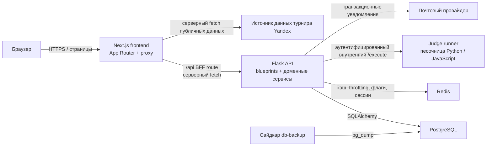
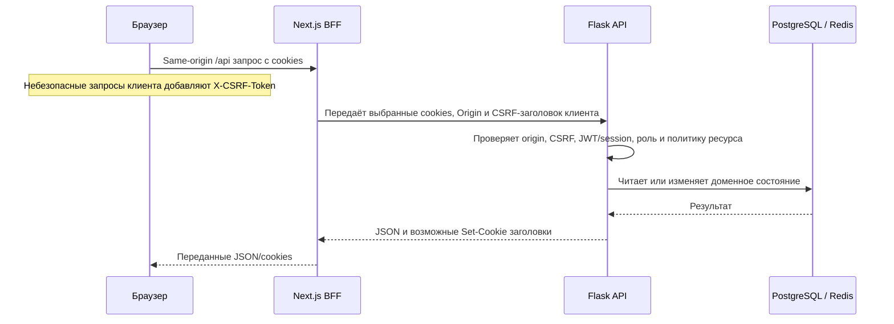

# Progyx Fullsite v3 — единый архитектурный и технический документ

## Паспорт документа

| Поле | Значение |
|---|---|
| Проект | Progyx Fullsite v3 / ProgHUB |
| Язык | Русский |
| Статус | Актуальное описание исходного кода на 2026-07-29 |
| Целевое окружение | Docker Compose: Next.js, Flask, PostgreSQL, Redis, `db-backup` и изолированный code judge |
| Канонический файл | `Progyx_Architecture.md` |
| Источник истины | Исполняемый код, тесты, `docker-compose.yml`, конфигурация и миграции текущего репозитория |
| Граница документа | Описывает устройство, контракты и ограничения; пошаговые опасные операции остаются в специализированных runbook'ах |

Прежний корневой `ARCHITECTURE.md`, устаревший `Progyx_Architecture_v1.0.md` и вложенная копия старого worktree удалены как дублирующие версии. Этот файл использует структуру единого технического справочника, но не переносит утверждения из устаревших документов без подтверждения кодом.

Конфигурация среды выполнения передаётся через переменные окружения и Docker secrets, поэтому может менять эксплуатационное поведение без изменения этого файла. Если между текстом и текущим исходным кодом возникает расхождение, верным считается код, после чего документ должен быть обновлён в том же изменении.

## Как пользоваться документом

| Аудитория | Читать в первую очередь | Цель |
|---|---|---|
| Новый разработчик | §§1–4, 6, 12 и 14 | Понять состав системы, маршруты запросов и структуру репозитория |
| Backend-разработчик | §§4–9, 13 | Изменять API, авторизацию, модели, миграции и judge без нарушения границ |
| Frontend-разработчик | §§3, 7, 9 | Работать с App Router, BFF, CSP и пользовательскими ограничениями маршрутов |
| DevOps / оператор | §§2, 6, 8, 10–11, 15 | Развернуть стек, обеспечить backup/DR и production-конфигурацию |
| QA / security reviewer | §§5, 8–9, 11, 14 | Проверить RBAC, сессии, изоляцию judge и негативные сценарии |
| Владелец продукта | §§1, 5, 10, 13 | Понять реализованные домены, границы текущей поставки и внешние зависимости |

Отдельные файлы `README.md`, `docs/operations/*.md`, `docs/email_unisender_go.md` и `docs/security/*.md` сохранены только там, где содержат самостоятельные инструкции, доказательства аудита или процедуры восстановления. Они не являются альтернативными описаниями архитектуры.

## 1. Обзор системы

Progyx — это платформа для обучения программированию с ролевой моделью доступа. Архитектурно это модульный монолит: Next.js предоставляет браузерный интерфейс, Flask владеет бизнес-правилами и постоянными данными, а отдельный внутренний сервис проверяет пользовательский код на Python и JavaScript.



### Архитектурные принципы

- Backend является источником истины для авторизации и бизнес-правил. Ограничения маршрутов во frontend улучшают UX, но не предоставляют права доступа.
- Код функций сгруппирован по доменам, а не по экранам: API blueprints предоставляют HTTP-контракты, сервисы содержат переиспользуемые доменные сценарии, SQLAlchemy-модели описывают постоянные данные.
- PostgreSQL — постоянное хранилище системы. Redis — слой ускорения и координации, а не единственный источник критичных данных.
- Произвольный код учащихся не выполняется во Flask-процессе и обрабатывается только внутренним judge runner.
- Чувствительные к безопасности сценарии используют явные проверки владения или ролей, серверные HTTP-only cookies сессии, CSRF-защиту для записей с cookie-аутентификацией и аудит привилегированных действий.
- Нумерованные миграции репозитория применяются через CLI приложения; обычные запросы не меняют схему базы неявно.

## 2. Топология развёртывания

`docker-compose.yml` определяет эталонный стек.

| Сервис | Ответственность | Сетевая доступность | Постоянные / смонтированные данные |
|---|---|---|---|
| `frontend` | Production-сервер Next.js и same-origin API BFF | Публичный порт `3000`; `backend_net` | Только собранное приложение |
| `backend-init` | Применяет миграции и seed/bootstrap-данные до запуска API | `backend_net`, `judge_net` | Общий том медиафайлов |
| `backend` | Flask/Gunicorn HTTP API и доменная логика | Публичный порт `8000`; `backend_net`, `judge_net` | Bind mounts для медиа и архива audit-логов |
| `db` | PostgreSQL — источник постоянных данных | Только `backend_net` | Том `postgres_data`; Docker secret с паролем |
| `redis` | Кэш, throttling, кэш версий сессий, feature flags, поддержка лидерборда | Только `backend_net` | Том `redis_data`; Docker secret с паролем |
| `db-backup` | Плановые резервные копии PostgreSQL и инструменты восстановления | `backend_net` | Том `postgres_backups` |
| `judge-runner` | Выполняет кодовые задания | Только `judge_net`; без порта хоста | Read-only root filesystem и ограниченный `/tmp` tmpfs |

`backend_net` объединяет frontend, Flask API, PostgreSQL, Redis, sidecar резервного копирования и job инициализации. `judge_net` является внутренней сетью: он соединяет backend-процессы (`backend` и `backend-init`) с runner и не даёт runner выходить в Интернет. Пользовательский Flask API — единственный компонент, обрабатывающий запросы и подключённый к обеим сетям.

### Порядок запуска

1. PostgreSQL и Redis становятся healthy.
2. `backend-init` запускает `flask --app run.py bootstrap-app`, применяя нумерованные миграции и seed-данные.
3. Judge runner становится healthy.
4. Flask API запускается после инициализации и готовности judge runner.
5. Frontend запускается после успешной проверки здоровья API.

## 3. Архитектура frontend

Frontend — приложение Next.js 16 App Router в `frontend/` с React, TypeScript, Tailwind CSS, GSAP, Monaco Editor и `react-hot-toast`.

### Пути запросов и рендеринга

| Слой | Расположение | Ответственность |
|---|---|---|
| Страницы и layouts App Router | `frontend/src/app/` | Публичные страницы, auth, интерфейсы учащегося, родителя, учителя, менеджера, admin и superadmin |
| Route proxy / edge guard | `frontend/src/proxy.ts` | CSP nonce на каждый запрос, обновление браузерной сессии, UX-проверки ролей для маршрутов и редиректы принудительной последовательности уроков |
| Браузерный API-клиент | `frontend/src/lib/api.ts` | Same-origin fetch, обработка JSON, обновление auth, передача CSRF-заголовка и нормализация ошибок UI |
| Server API helper | `frontend/src/lib/server-api.ts` | Запросы Server Components с выбранными auth cookies и внутренним URL API |
| BFF route | `frontend/src/app/api/[...path]/route.ts` | Передаёт выбранные заголовки/cookies от браузера к Flask, не создавая искусственно значения `Origin` или CSRF |
| Общий UI | `frontend/src/components/` | Функциональные панели страниц, lesson player, Monaco editor, сообщения, dashboards, staff-инструменты и навигация |
| Общие контракты | `frontend/src/types/index.ts` | TypeScript-контракты API и UI-данных |

Браузер обычно вызывает `NEXT_PUBLIC_API_URL`. В эталонном Compose-развёртывании это same-origin BFF route `/api` frontend. Server Components и proxy используют `INTERNAL_API_URL`, чтобы обратиться к Flask напрямую через `backend_net`.

`src/proxy.ts` декодирует только минимум метаданных access token для выбора пользовательского интерфейса. Каждый защищённый backend-запрос всё равно проходит Flask-проверки токена, роли, владения, публикации, origin и CSRF.

### Продуктовые области маршрутов

| Область | Основной префикс маршрута | Примечание |
|---|---|---|
| Публичная | `/`, `/it-career`, `/tournament`, `/support`, `/bug-hunter` | Турнир — server-rendered публичное представление с ограниченным и кэшированным получением данных Yandex. |
| Идентификация | `/auth`, `/forgot-password`, `/reset-password`, `/verify-email` | Создание cookie-сессии, подтверждение email, восстановление пароля и refresh принадлежат Flask. |
| Учащийся | `/dashboard`, `/roadmap`, `/lessons`, `/leaderboard`, `/useful`, `/profile` | Учебная программа, прогресс, задания, квизы, достижения, косметика и лидерборд. |
| Учитель | `/teacher` | Управление классами, lesson builder, задания и проверка решений. |
| Родитель | `/parent` | Доступ по связи с ребёнком, прогресс, согласия, уведомления и сообщения родитель—учитель. |
| Менеджер | `/manager` | Ограниченный справочник контактов и аудируемые/rate-limited рассылки; менеджеры не получают доступ к учебной программе. |
| Администрирование | `/admin`, `/superadmin` | Операции системы, контент, support, audit-логи, управление пользователями и доступные только superadmin операции со staff/manager. |

## 4. Архитектура backend

Flask app factory в `backend/app/__init__.py` загружает `Config`, проверяет production-требования, инициализирует SQLAlchemy/CORS, регистрирует blueprints, подключает request-защиты, правила статических медиафайлов, security headers, CLI-команды и необязательные operational jobs.

### API blueprints

| Blueprint | Префикс | Ответственность домена |
|---|---|---|
| `auth.py` | `/api/auth` | Регистрация, login/logout, refresh, текущий пользователь, подтверждение email, сброс пароля, отзыв сессий |
| `student.py` | `/api` | Dashboard, учебная программа, доступ к урокам, прогресс, задания, квизы, достижения, вступление в класс, лидерборд |
| `teacher.py` | `/api/teacher` | Подтверждение учителей, владение классами, custom lessons/modules, задания, оценивание, представления учителя |
| `parent_cabinet.py` | `/api/parent` | Связи родитель—ребёнок, настройки согласия/приватности, сведения о ребёнке, потоки родитель—учитель, billing placeholder |
| `messaging.py` | `/api/messaging` | Диалоги учитель/учащийся и состояние прочтения |
| `staff_messaging.py` | `/api/staff-messaging` | Прямые staff-диалоги с авторизацией участников |
| `notifications.py` | `/api/notifications` | Лента in-app уведомлений и настройки |
| `support.py` | `/api/support` | Support tickets, сообщения тикетов, staff moderation, bug-hunter reports |
| `admin.py` | `/api/admin` | Операции admin/superadmin, контент и пользователи, telemetry, audit logs, справочник контактов, рассылки |
| `cosmetics.py` | `/api` | Каталог косметики и состояние полученной косметики |
| `useful.py` | `/api/useful` | Каталог полезных учебных заданий |

### Доменные сервисы и core-модули

| Область | Основные модули | Ответственность |
|---|---|---|
| Аутентификация и авторизация | `core/security.py`, `core/throttle_redis.py` | Хэширование паролей, JWT signing/key rotation, проверка токенов/сессий, role decorators, CSRF/origin checks, инвалидация версий сессий, rate limits |
| Конфигурация и инфраструктура | `core/config.py`, `core/db.py`, `core/redis_client.py` | Проверка переменных окружения, SQLAlchemy, доступ к Redis и неймспейсы ключей |
| Учебный workflow | `core/assignment_sync.py`, `core/achievements.py`, `core/gamification.py` | Синхронизация заданий, обновление прогресса/достижений, XP/уровни |
| Gateway проверки кода | `core/code_judge.py` | Проверяет режим задания и отправляет payload кода/тестов в runner; local fallback отключён по умолчанию |
| Контент и медиа | `services/assignment_images.py`, `models/media.py` | Генерация обложек заданий и проверяемые ссылки на медиа |
| Коммуникации | `services/notifications.py`, `services/email_service.py`, `services/staff_messaging.py`, `services/parent_messaging.py` | In-app уведомления, транзакционная почта, прямые staff-сообщения, потоки родитель/учитель |
| Семья и приватность | `services/parent_insights.py`, `services/parent_privacy.py`, `services/parent_event_notifications.py` | Связи с родителями, согласия, представление данных ребёнка и уведомления родителям |
| Операции и support | `services/audit_log_archive.py`, `services/site_activity_log.py`, `services/support_tickets.py`, `services/bug_hunter.py` | Экспорт audit-логов, журнал активности запросов, workflow support tickets, модерируемые bug reports |
| Миграции и bootstrap | `core/migrations.py`, `cli.py`, `seed/bootstrap.py`, `seed/learning_content.py` | Custom нумерованные миграции, bootstrap, seed-данные, эксплуатационные команды |

`core/gigachat.py` остаётся в репозитории, но endpoint GigaChat для учащегося намеренно возвращает `404`, пока не будет завершена внешняя работа с credential и историей Git. Это не активная продуктовая зависимость.

## 5. Идентификация, роли и авторизация

В постоянном `UserRole` enum определены шесть ролей:

| Роль | Основная область |
|---|---|
| `student` | Доступная/назначенная учебная программа, личный прогресс и членство в классе |
| `teacher` | Собственные классы, custom curriculum класса, задания и проверка учащихся |
| `parent` | Данные явно привязанного ребёнка и коммуникации родителя |
| `manager` | Справочник контактов, ограниченный записями student/teacher/parent, и контролируемые рассылки |
| `admin` | Администрирование платформы/контента и preview учебной программы |
| `superadmin` | Все права admin и управление жизненным циклом администраторов/менеджеров |

Авторизация зависит от ресурса:

- Глобальная учебная программа для ролей учащихся требует опубликованных module и lesson.
- Custom classroom module доступен только зачисленным учащимся, владеющему учителю и ролям административного preview.
- Менеджеры намеренно исключены из ролей участников учебной программы.
- Доступ родителя основан на активных связях родитель—ребёнок, а не только на email или URL.
- Сообщения, support tickets, задания, оценки и staff threads проверяют отношение участника или владельца перед чтением и записью.
- Изменения состояния admin и manager создают `AdminAuditLog`; у рассылок менеджеров также есть настраиваемый rate limit на менеджера.

## 6. Архитектура данных

PostgreSQL — постоянная база данных. SQLAlchemy-модели сгруппированы по ограниченным доменам в `backend/app/models/`.

| Агрегат | Основные модели | Примечания |
|---|---|---|
| Идентификация и аудит | `User`, `RefreshToken`, `EmailToken`, `SecurityThrottle`, `AdminAuditLog`, `SiteActivityLog` | Версионирование сессий, подтверждение/восстановление email, auth throttles, административный audit trail |
| Обучение | `Module`, `Lesson`, `Task`, `Quiz`, `Classroom`, `ClassMembership`, `ClassJoinRequest`, `Assignment`, `AssignmentSubmission`, `UserProgress` | Опубликованная глобальная программа и custom curriculum, которым владеет учитель |
| Прогресс и вовлечение | `Achievement`, `UserAchievement`, `UserOwnedCosmetic`, `UsefulTask`, `PlatformKv` | XP, уровни, косметика, полезная практика, настройки уровня платформы |
| Parent cabinet | `ParentChildLink`, `ParentLinkCode`, `ParentConsentSettings`, `ParentSafetySettings`, `ParentNotification`, модели thread/message/read-state родитель—учитель | Доступ к данным ребёнка и коммуникации основаны на связях |
| Сообщения и support | `Conversation`, `Message`, `ConversationReadState`, `StaffDirectThread`, `StaffDirectMessage`, `SupportTicket`, `SupportTicketMessage` и модели read-state | Отдельные домены коммуникаций участников, staff и support |
| Уведомления и moderation | `UserNotification`, `UserNotificationPreference`, `EmailNotificationLog`, `BugHunterReport` | История in-app/email-доставки и staff moderation |
| Медиа | `MediaAsset` | Ссылки на контролируемые ассеты обложек заданий |

### Жизненный цикл схемы

Миграции — Python-модули в `backend/app/migrations/`, упорядоченные по именам ревизий и зафиксированные в таблице `schema_migrations`. Используйте Flask CLI вместо ручных изменений схемы:

```text
flask --app run.py upgrade-db
flask --app run.py bootstrap-app
flask --app run.py seed-data
```

Compose-сервис `backend-init` запускает команду bootstrap до готовности API-контейнера.

### Ответственность Redis

Redis необязателен в development и обязателен проверкой production-конфигурации. Он поддерживает:

- данные лидерборда и кэша;
- кэш версий сессий для отозванных сессий;
- координацию throttling с fallback/dual mode через базу данных;
- поиск feature flag режима обслуживания;
- кэш OAuth token GigaChat, только если dormant-интеграцию снова включат.

Постоянные данные пользователей, программы, оценок, аудита и уведомлений остаются в PostgreSQL.

### Топология данных Redis

Все ключи имеют префикс `progyx:<app_env>:<домен>`, поэтому разные окружения не смешивают данные. В ключи не помещаются сырые JWT, email и IP-адреса: для throttle используются канонизированные хеш-фрагменты. Логические базы распределены так:

| База Redis | Назначение | Характер хранения |
|---|---|---|
| `0` | Глобальный лидерборд и OAuth-кэш GigaChat, если интеграцию снова включат | Кэш с TTL; результат можно восстановить из PostgreSQL или получить заново |
| `1` | Кэш `session_version` пользователя | Ускоряет проверку отзыва сессии; истинная версия хранится в PostgreSQL |
| `2` | Rate limiting | `INCR`/`EXPIRE` в Redis с PostgreSQL fallback или dual-write согласно `THROTTLE_BACKEND` |
| `3` | Зарезервировано | Будущий broker Celery, в текущей реализации не используется |
| `4` | Зарезервировано | Будущий Celery result backend, в текущей реализации не используется |

TTL глобального лидерборда задаётся `GLOBAL_LEADERBOARD_REFRESH_INTERVAL`; флаг `flags:maintenance` читается с коротким локальным TTL-кэшем. Неработоспособность Redis не должна приводить к потере постоянных данных: для допустимых сценариев приложение использует деградацию к PostgreSQL, а production startup требует корректного Redis URL и секрета. Точная диагностика ключей, отказов и эксплуатационные действия описаны в `docs/operations/redis.md`.

## 7. Основные потоки

### Браузерный API-вызов



### Проверка кодового задания

```mermaid
sequenceDiagram
    participant L as Учащийся
    participant F as Flask task API
    participant J as Judge runner
    participant W as Worker с UID на запрос

    L->>F: Отправляет код для разрешённого задания
    F->>F: Проверяет доступ к уроку/заданию и task validation
    F->>J: Аутентифицированный внутренний /execute запрос
    J->>J: Выделяет уникальный UID и приватный workspace 0700
    J->>W: Запускает тесты Python или Node с ограниченными потоками
    W-->>J: Агрегированный результат выполнения
    J->>J: Завершает process group и оставшиеся процессы UID; удаляет workspace
    J-->>F: Внутренний отчёт с диагностикой по кейсам
    F->>F: Преобразует его в безопасный для учащегося агрегированный результат
    F-->>L: Score/count/обобщённый feedback без скрытых тестовых данных
```

## 8. Граница изоляции code judge

`judge_runner/app.py` и `shared/judge/engine.py` реализуют runner. Flask API — единственный предполагаемый вызывающий компонент и передаёт bearer token по `judge_net`.

Защита runner включает:

- read-only container filesystem с ограниченным `noexec,nosuid` `/tmp` tmpfs;
- внутреннюю Docker-сеть без default gateway;
- ограничения одновременных запросов и тестов, а также cgroup, memory, CPU, PID и file-descriptor limits;
- потоковое чтение stdout/stderr в ограниченные буферы вместо неограниченного `communicate()`;
- отдельную process group для каждого worker и финальный обход `/proc` по UID задания для detached descendants;
- никогда не переиспользуемый числовой UID и workspace `0700` для каждого submission;
- allowlist окружения и закрытые file descriptors worker;
- self-exec bootstrap, который удаляет token runner из process environment до того, как HTTP socket начнёт принимать работу;
- Docker capability drop с возвратом только setup/cleanup capabilities dispatcher (`CHOWN`, `SETUID`, `SETGID`, `DAC_OVERRIDE`, `KILL`).

Для работы границы UID/capability dispatcher должен запускаться в Linux Docker/Compose. Шаги проверки хоста и текущие ограничения песочницы описаны в `docs/operations/sandbox.md`.

## 9. Границы безопасности

| Граница | Кем обеспечивается | Важное поведение |
|---|---|---|
| Браузер → frontend | Next proxy и CSP | CSP с nonce, security headers, UX guards маршрутов, токены не сохраняются в browser storage |
| Frontend → Flask | BFF route и Flask | Передача same-origin cookies; BFF не синтезирует доказательства origin или CSRF |
| Сессия и write requests | Flask security core | HTTP-only cookies, проверка декодирования/подписи токена, проверка версии сессии, строгий origin, double-submit CSRF |
| Доменные данные | Blueprint/resource policies | Проверки роли, владения, членства, публикации, участника и link |
| Привилегированные операции | Admin API и сервисы | Операции жизненного цикла superadmin, audit logs, минимизация контактов manager и throttling рассылок |
| Медиа | Flask static media routes / media services | Path-safe отдача, allowlist расширений, контролируемые generated/uploaded assets |
| Произвольный код | Judge runner | Отдельный сервис, ограничение сети, per-job identity/workspace, process/resource controls |
| Секреты | Environment и Docker secrets | Пароли PostgreSQL/Redis передаются как файлы в `/run/secrets`; слабые production secrets отклоняются на старте |

## 10. Внешние интеграции и намеренно незавершённые области

| Интеграция | Текущее состояние | Архитектурная обработка |
|---|---|---|
| Транзакционная почта | Активна при настройке | Единственный реализованный провайдер — Unisender Go; `services/email_service.py` и сервис notifications создают и журналируют доставку |
| Данные турнира Yandex | Активный публичный read path | `frontend/src/lib/tournament-data.ts` выполняет server-side ограниченное/кэшированное получение и сообщает странице о проблемах источника |
| GigaChat | Отключён | Endpoint возвращает `404`; код/config остаются до завершения внешней работы с credential и историей Git |
| Parent billing | Placeholder | `/api/parent/billing` возвращает не списывающий деньги placeholder; платёжный провайдер не интегрирован |
| Резервные копии | Активный Compose sidecar | `db-backup` запускает скрипты репозитория против PostgreSQL и пишет в `postgres_backups` |

### Транзакционная почта

Почтовый контур обслуживает подтверждение email, повторную отправку подтверждения, восстановление и сброс пароля, а также продуктовые уведомления. Одноразовый токен передаётся пользователю только в ссылке; в `email_tokens` сохраняется его `SHA-256`-хеш. Стандартные TTL: `EMAIL_VERIFICATION_TOKEN_TTL_MINUTES=1440` и `PASSWORD_RESET_TOKEN_TTL_MINUTES=30`.

Конфигурация включает `UNISENDER_GO_API_KEY`, URL дата-центра провайдера, `EMAIL_FROM`, `FRONTEND_PUBLIC_URL`, опциональный `EMAIL_REPLY_TO`, переключатели `SEND_MAIL`, `SEND_NOTIFICATION_EMAILS`, `EMAIL_DRY_RUN` и cooldown уведомлений о сообщениях. Режим dry-run не вызывает провайдера, но оставляет поток токенов проверяемым локально. Еженедельный отчёт родителю выполняется одной внешней задачей через `flask --app backend/app send-weekly-parent-progress-emails`; in-process scheduler отключён по умолчанию и сохранён только для совместимости. Для доставляемости домен отправителя должен быть верифицирован у провайдера с DKIM/SPF и рекомендуемым DMARC. Полные безопасные шаги настройки и тестирования находятся в `docs/email_unisender_go.md`.

### Резервное копирование и восстановление

Сайдкар `db-backup` делает `pg_dump --format=custom` в том `postgres_backups` с периодом `BACKUP_INTERVAL_SECONDS` (по умолчанию 24 часа). Рядом с каждым сжатым дампом `progyx-<UTC timestamp>.sql.custom.gz` создаётся SHA-256 checksum; политика хранения `BACKUP_RETENTION_DAYS` по умолчанию сохраняет 14 дней и всегда оставляет самый новый файл. Восстановление выполняет `scripts/restore.sh`, оборачивающий `pg_restore --clean --if-exists`.

Плановый ориентир DR: RPO 24 часа, RTO 2 часа и MTTR 4 часа при условии, что резервная копия уже доступна на целевом хосте. Описание процедуры восстановления намеренно остаётся отдельным runbook'ом `docs/operations/dr.md`, поскольку оно содержит разрушительные операционные команды; проектирование и параметры контура зафиксированы здесь.

### Условия production-поставки

В исходном Compose сейчас используются теги базовых образов (`postgres:17`, `redis:7-alpine`, `python:3.12-slim`, `node:22-alpine`), а не зашитые digest'ы. Перед production-сборкой операторы обязаны разрешить и закрепить digest для каждого runtime-образа скриптом `scripts/pin-images.sh`, затем обновить Dockerfile/Compose и зафиксировать полученные значения. Это предотвращает незаметную замену базовой ОС и делает CVE/SBOM-проверки воспроизводимыми. Подробный порядок находится в `docs/operations/image-pinning.md`.

### Открытые внешние обязательства

- Исторический ключ GigaChat должен быть отозван, а прежний `.env` — удалён из истории Git утверждённой процедурой до повторного включения интеграции.
- Полная Linux-проверка свежесобранного образа runner необходима перед production: локальная Docker-среда во время последнего аудита отдавала устаревший образ.
- Наблюдаемость уровня Sentry/Prometheus, multi-tenant изоляция, SSO/SAML и настоящий биллинг не реализованы и не должны считаться частью текущей архитектуры.

Внешние действия и доказательства аудита остаются в `docs/operations/security-followups.md` и `docs/security/2026-07-29-source-security-assessment.md`: это не дубли архитектуры, а проверяемые записи и runbook'и владельца инфраструктуры.

## 11. Операции, наблюдаемость и CI

- `GET /api/health` сообщает состояние API и Redis, если Redis настроен.
- `METRICS_DEBUG` включает response headers и логи с длительностью запроса/числом SQL-запросов.
- Журнал активности сайта и административные audit-логи хранятся постоянно; архив audit-логов можно экспортировать Flask CLI-командой.
- Еженедельное письмо о прогрессе ребёнка доступно через CLI. In-process scheduler сохранён только для совместимости; в production следует использовать один внешний scheduler.
- GitHub Actions компилирует/мигрирует/тестирует backend, запускает Redis-backed regression suite, typecheck/build frontend и smoke-test Compose-стека.
- Production startup проверяет отсутствие placeholder secrets, secure/strict cookies, JWT key material, Redis configuration, заданные API URLs и силу runner token.

## 12. Карта репозитория

```text
backend/
  app/
    api/             HTTP blueprints по доменам
    core/            конфигурация, безопасность, persistence, caching, migrations, judge gateway
    models/          SQLAlchemy-модели постоянных данных по доменам
    services/        переиспользуемые workflow и внешние интеграции
    migrations/      упорядоченные ревизии схемы
    seed/            bootstrap и учебный контент
  tests/             backend и security regression tests
frontend/
  src/app/           страницы, layouts и BFF route Next.js App Router
  src/components/    функциональные и общие React-компоненты
  src/lib/           browser/server transport, environment и presentation helpers
  src/proxy.ts       CSP, refresh сессии и UX guard маршрутов
shared/judge/        независимые от runner execution engine и контракты
judge_runner/        защищённый HTTP dispatcher, Docker image и seccomp profile
docs/operations/     runbooks развёртывания, backup, Redis, image pinning и sandbox
scripts/             backup, restore и image-pinning helpers
docker-compose.yml   эталонная local/production-like топология
```

## 13. Рекомендации по изменениям

| Изменение | Обновляйте совместно |
|---|---|
| Добавление роли пользователя | `UserRole`, миграцию, backend authorization policies, frontend `UserRole`/proxy rules/navigation, role-specific tests, этот документ |
| Добавление домена API | Новый blueprint, service/model при необходимости, регистрация blueprint в `create_app`, frontend transport/types/pages, authorization и negative tests |
| Изменение видимости программы | Policy helpers в `student.py`, publication behavior teacher/admin, ответы lesson/module, role/class regressions; никогда не полагайтесь только на скрытие во frontend |
| Добавление режима проверки задания | Нормализацию task validation, judge gateway/runner только при выполнении кода, learner-safe response DTO, builder UI/types, security tests |
| Изменение limits/isolation runner | `shared/judge/`, `judge_runner/`, Compose capabilities/networks, `docs/operations/sandbox.md`, Linux runtime validation |
| Добавление постоянных данных | Model, нумерованную migration, registry импорта моделей, seed/serialization/tests, последствия для backup/restore |
| Добавление уведомлений/email | Notifications service, поведение preferences/deduplication, provider configuration, delivery logging, operational scheduling |

## 14. Базовая проверка

После архитектурных изменений запускайте минимально нужные проверки и межсервисную базовую проверку:

```text
python -m unittest discover -s backend/tests -v
npm --prefix frontend run typecheck
npm --prefix frontend run build
docker compose config --quiet
```

При изменениях judge runner дополнительно пройдите Linux runtime checklist из `docs/operations/sandbox.md`. При изменениях ролей, видимости программы, сообщений, parent links или staff operations добавляйте negative authorization tests, а не ограничивайтесь happy-path coverage.

## 15. Разработка, выпуск и сопровождение документации

### Локальный старт

Базовый сценарий разработки описан в `README.md`: создайте локальный `.env` по `.env.example`, подготовьте секреты Docker из файлов-примеров и запустите `docker compose up --build`. После старта UI доступен на `http://localhost:3000`, прямой Flask API — на `http://localhost:8000/api`, а health endpoint — на `/api/health`.

Для изолированной проверки изменений используйте тесты backend, `npm --prefix frontend run typecheck`, `npm --prefix frontend run build` и `docker compose config --quiet`. Не запускайте пользовательский код вручную за пределами `judge-runner` и не включайте локальный fallback judge в недоверенной среде.

### Минимальный production checklist

- Установить `APP_ENV=production`, отключить demo-данные и задать явные public/internal API URL.
- Передать сильные уникальные `SECRET_KEY`, JWT key material, runner token, пароли PostgreSQL/Redis и ключ провайдера почты через окружение или Docker secrets; не коммитить их в Git.
- Включить HTTPS на внешнем reverse proxy, `SESSION_COOKIE_SECURE=true` и строгий SameSite; не публиковать `judge-runner`, PostgreSQL или Redis на host без отдельной административной необходимости.
- Разрешить и закрепить digest всех runtime-образов, пересобрать runner на Linux и пройти его runtime checklist.
- Убедиться, что backup выполняется, checksum создаётся, а восстановление отрепетировано по `docs/operations/dr.md`.
- Выполнить проверки из §14 и проверить production startup validation до открытия доступа пользователям.

### Правила актуализации

- Изменение API, роли, модели, миграции, топологии Compose, security boundary или внешней интеграции сопровождается обновлением соответствующего раздела этого файла в той же ветке.
- Для повторяемого операционного действия хранится один runbook; в архитектуре остаются назначение, граница ответственности и ссылка на него, а не копия последовательности команд.
- Прошлые планы, аудиты и roadmap не описываются как реализованный функционал. Они сохраняются только как evidence или явно помеченные внешние обязательства.
- Перед удалением документации необходимо проверить, что она не содержит уникальные требования продукта, процедуру восстановления, обязательства безопасности или доказательства аудита.
